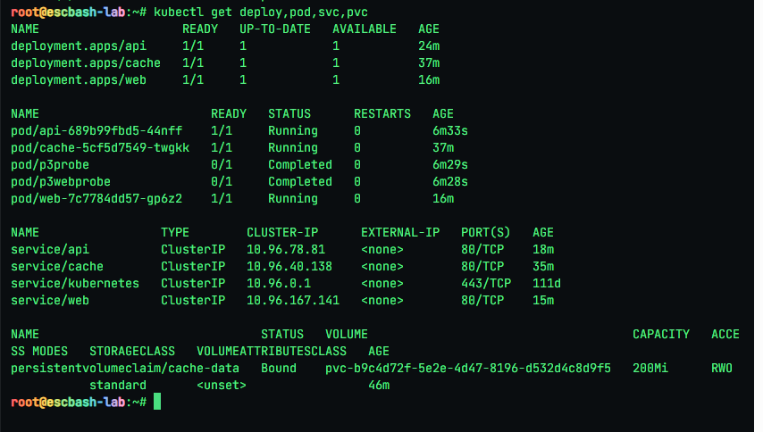
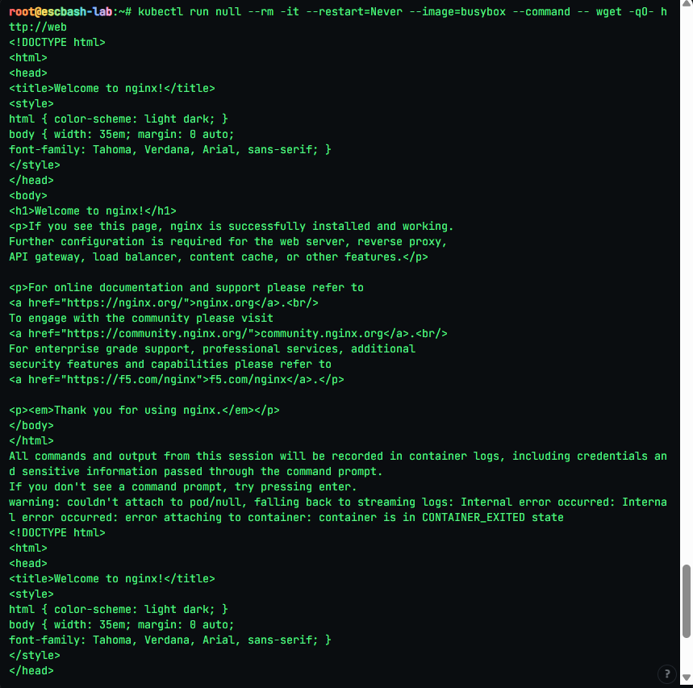
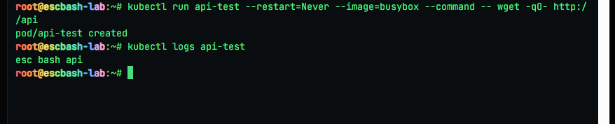

# 🚀 Kubernetes Multi-Tier Application

## 📌 Project Overview

This project demonstrates how to deploy a three-tier application on Kubernetes using separate Deployments and Services.

The application consists of three tiers:

- **Frontend:** NGINX
- **Backend:** HashiCorp HTTP Echo
- **Data Tier:** Redis with Persistent Storage

Each tier runs independently inside a Kubernetes cluster and is exposed using ClusterIP Services.

This project was completed as part of my Kubernetes hands-on learning journey with **ESC Bash**.

---

## 🏗️ Architecture

```text
                  Kubernetes Cluster
                          
                         User
                          |
                          v
                   +-------------+
                   |  Web Tier   |
                   |    NGINX    |
                   |  Port: 80   |
                   +-------------+
                          
                   +-------------+
                   | Backend API |
                   |  HTTP Echo  |
                   |  Port: 5678 |
                   +-------------+
                          
                   +-------------+
                   |  Data Tier  |
                   |    Redis    |
                   |  Port: 6379 |
                   +-------------+
                          |
                          v
                   +-------------+
                   | Persistent  |
                   |   Storage   |
                   |    PVC      |
                   +-------------+
```

## 🛠️ Technologies Used

- Kubernetes
- Docker
- NGINX
- Redis
- HashiCorp HTTP Echo
- YAML

---

## 📂 Project Structure

```text
kubernetes-multi-tier-app/
│
├── api-deployment.yaml
├── api-service.yaml
├── cache-deployment.yaml
├── cache-service.yaml
├── pvc.yaml
├── secret.yaml
├── web-deployment.yaml
├── web-service.yaml
├── README.md
│
└── screenshots/
    ├── 01-kubernetes-resources-status.png
    ├── 02-frontend-nginx-verification.png
    └── 03-backend-api-verification.png
```

---

## ⚙️ Kubernetes Resources Implemented

| Resource | Name | Purpose |
|---|---|---|
| Deployment | web | Runs the frontend |
| Service | web | Exposes frontend on port 80 |
| Deployment | api | Runs the backend API |
| Service | api | Exposes API on port 80 |
| Deployment | cache | Runs Redis |
| Service | cache | Exposes Redis on port 6379 |
| Secret | api-secret | Stores API_TOKEN |
| PersistentVolumeClaim | cache-data | Provides persistent storage |

---

## 🔹 Implementation Details

### 1. Frontend Tier – NGINX

- Deployed NGINX using `nginx:alpine`.
- Created a Deployment with one replica.
- Exposed the frontend using a ClusterIP Service on port 80.
- Verified the NGINX welcome page using the internal Service URL.

### 2. Backend Tier – API

- Deployed `hashicorp/http-echo:latest`.
- Configured container arguments to serve `esc bash api` on port 5678.
- Created a Kubernetes Secret named `api-secret`.
- Injected the `API_TOKEN` environment variable using `secretKeyRef`.
- Created a ClusterIP Service on port 80 forwarding traffic to port 5678.

### 3. Data Tier – Redis

- Deployed Redis using `redis:7-alpine`.
- Created a PersistentVolumeClaim named `cache-data`.
- Mounted persistent storage at `/data`.
- Exposed Redis using a ClusterIP Service on port 6379.
- Verified that the PVC reached the `Bound` status.

---

## 🚀 Deployment Instructions

### Step 1: Clone the Repository

```bash
git clone <your-github-repository-url>
cd kubernetes-multi-tier-app
```

### Step 2: Apply Kubernetes Manifests

```bash
kubectl apply -f .
```

### Step 3: Verify Deployments

```bash
kubectl get deployments
```

### Step 4: Verify Pods

```bash
kubectl get pods
```

### Step 5: Verify Services

```bash
kubectl get svc
```

### Step 6: Verify PersistentVolumeClaim

```bash
kubectl get pvc
```

### Step 7: Verify Secret

```bash
kubectl get secrets
```

---

## 🧪 Application Verification

### 1. Backend API Verification

Run a temporary BusyBox Pod to test backend connectivity:

```bash
kubectl run api-test --restart=Never --image=busybox --command -- wget -qO- http://api
```

**Expected Output:**

```text
esc bash api
```

### 2. Frontend Verification

Test the frontend using the internal Kubernetes Service:

```bash
kubectl run web-test --restart=Never --image=busybox --command -- wget -qO- http://web
```

**Expected Result:**

NGINX Welcome Page HTML.

---

## 📸 Project Screenshots

### 1. Kubernetes Resources Status

Verified all three Deployments, running Pods, Services, and PersistentVolumeClaim.



### 2. Frontend Verification – NGINX

Verified frontend accessibility using the internal Kubernetes Service URL `http://web`.



### 3. Backend API Verification

Verified backend API connectivity using the internal Kubernetes Service URL `http://api`.

**Expected Response:**

```text
esc bash api
```



---

## 📚 Key Learnings

Through this hands-on project, I gained practical experience with:

- Kubernetes Deployments and Replica Management
- Kubernetes Services and Internal Service Discovery
- Container Arguments
- Secrets and Environment Variables
- PersistentVolumeClaims (PVC)
- Persistent Storage
- Multi-Tier Application Deployment
- Application Connectivity and Troubleshooting

---

## 🎯 Conclusion

Successfully deployed and verified a three-tier application on Kubernetes with separate frontend, backend, and data-tier components.

This project strengthened my understanding of Kubernetes resource management, service discovery, Secret management, and persistent storage.

**Learning by building, testing, and troubleshooting! 🚀**

---

**Training:** ESC Bash

**Project:** Kubernetes Multi-Tier Application
